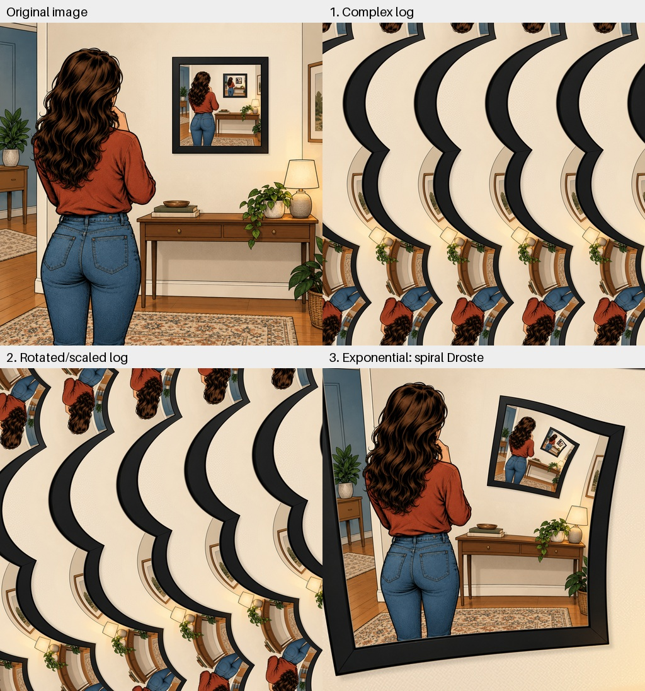
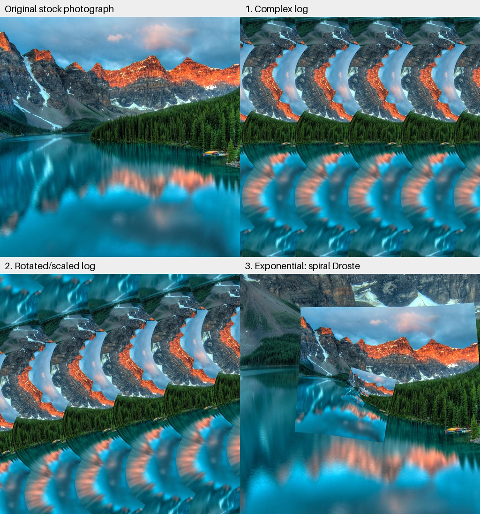

# Droste and complex-log image experiment

An experiment in making a recursive picture, unwrapping it with a complex
logarithm, rotating its log plane, and applying the exponential to create a
spiral. A second experiment runs the **same renderer on an ordinary stock
photo**, without first adding nested copies.

## View the results

| Experiment | Final image | All stages in one image |
| --- | --- | --- |
| Recursive picture frame | [Spiral result](escher_output/03_escher.png) | [2x2 transformation grid](escher_output/04_transformation_grid.png) |
| Ordinary stock photograph | [Spiral result](stock_experiment/03_escher.png) | [2x2 transformation grid](stock_experiment/04_transformation_grid.png) |

Quick previews:

### Recursive source



### Non-Droste stock source



Each grid is arranged in reading order:

```text
+--------------------------+--------------------------+
| Original image           | Complex-log image        |
+--------------------------+--------------------------+
| Rotated/scaled log image  | Exponential: final image |
+--------------------------+--------------------------+
```

Individual transformation stages are **4096 x 4096 pixels**. The grids are
**4096 x 4224 pixels**, including captions. Each output directory also contains
`preview.jpg`, `stages.jpg`, and `parameters.json` with the exact settings.

## 1. Make a nested-frame image

We began with `demo.png`, then chose the square illustration `demo2.png` because
its nearly square empty picture frame was better suited to recursive placement.

- Original `demo2.png`: **1254 x 1254 pixels**.
- Upscaled version `demo2_4096.png`: **4096 x 4096 pixels**, using Lanczos.
- First recursive result `demo2_nested.png`: copies fill the existing frame.
  Its opening is **1332 x 1313 pixels**, approximately 32.52% x 32.06% of the
  whole image, or about a 3.1:1 linear ratio.
- Revised `demo2_nested_quarter.png`: an **exact 1024 x 1024 pixel opening**,
  one quarter of the 4096-pixel image in both width and height.

"One quarter" here means **linear dimensions**, not area. A quarter-width,
quarter-height copy occupies 1/16 of the full image area.

The quarter-scale script reconstructs the wall behind the old frame, resizes
the actual black frame, and places recursive copies in the new opening. It does
not simply place a small image in a large blank mat. The nested widths are:

```text
4096 -> 1024 -> 256 -> 64 -> 16 -> 4 -> 1 pixels
```

The opening's pixel-edge bounds are `(2287, 537, 3311, 1561)`, excluding the
black border. The original files are preserved.

Recreate it with:

```powershell
.venv\Scripts\python.exe create_nested.py
```

This script is specifically calibrated to the supplied `demo2.png`; it is not
an automatic picture-frame detector.

## 2. Transform the recursive image into a spiral

The pipeline is:

```text
Nested image -> complex log -> log-plane rotation/scale -> exponential -> spiral
```

The recursion maps a full-image coordinate into the frame by
`z -> t + s*z`, where `s=1/4` and `t=(2287, 537)` in raster coordinates.
The fixed point of this map is:

```text
p = t / (1-s) = (3049.333333333333, 716)
```

This is the correct complex origin, not the frame's geometric center.
We use pixel-edge coordinates, with pixel centers at `(x+0.5, y+0.5)`, and
positive imaginary coordinates pointing up rather than down.

Let `L = ln(4)`, with normalized complex coordinates measured relative to `p`.
The forward transform is:

```text
w = log(z)
a = 1 - i*n*L/(2*pi)
c = 1/a
z_out = exp(c*w)
```

An arbitrary pure rotation can create an angular branch seam. Here the integer
winding `n` and a small uniform scale correction ensure
`c*(n*L + 2*pi*i) = 2*pi*i`. For `n=1`, the log-plane rotation is about
**12.442150 degrees**, and its uniform scale factor is about **0.97651404**.
These are log-plane settings, not a simple rotation angle for the final photo.
The final spiral's repeating scale and orientation are recorded separately in
`parameters.json`.

The renderer inverse-maps the continuous coordinates rather than rotating a
cropped intermediate bitmap. It uses bilinear interpolation, 2x2 subpixel
sampling by default, and row blocks to limit temporary memory.

The current recursive-source result includes a final-view correction so the
main woman stands upright and remains visible. Reproduce that version with:

```powershell
.venv\Scripts\python.exe create_escher.py --view-rotation-deg -10.823111593168614 --view-scale 0.5 --view-offset 0 0.06
```

This rotates the view about **10.823 degrees clockwise**, zooms out, and shifts
the composition downward by 6% of the canvas. The reference head-to-hip axis is
vertical; smaller nested copies still rotate progressively inward. The view is
resampled from the continuous periodic source, so there are no empty rotation
corners. The log intermediate is updated consistently with the corrected view.
The previous final is retained as `escher_output/03_escher_before_upright.png`.

Running `create_escher.py` without view flags recreates the original,
uncorrected framing. These flags are independent of the source's log-plane
rotation. See [ESCHER.md](ESCHER.md) for the detailed transform.

## 3. Control experiment: an ordinary stock photograph

To see whether a prepared Droste source was necessary, we used a normal
mountain-and-lake photograph by **James Wheeler**:

- [Original photo on Pexels](https://www.pexels.com/photo/lake-and-mountain-417074/)
- [Downloaded copy on Wikimedia Commons](https://commons.wikimedia.org/wiki/File:Pexels-james-wheeler-417074.jpg)
- [Local source and processing details](stock_experiment/SOURCE.md)

The original is **4226 x 2847 pixels**. It was center-cropped to a square and
resampled to 4096 x 4096 as `stock_experiment/input_4096.png`.
**No nested frames or smaller copies were inserted into this input.**

We ran the same script with the origin at the center of this image:

```powershell
.venv\Scripts\python.exe create_escher.py --input stock_experiment/input_4096.png --output-dir stock_experiment --center 2048 2048 --ratio 4 --turns 1
```

### What the result demonstrates

The stock image becomes a repeating spiral too, but it has visible hard joins.
The renderer **extends its input periodically in log-radius**, folding samples
into the rectangular region between the outer image and a hypothetical
quarter-size inner image. This extension supplies the repetition even when
the input photo itself contains none.

For the prepared recursive source, these boundaries already correspond to
matching content. For the stock photograph, the boundaries do not match, so
mountains, sky, trees, and water are abruptly joined along the repeated seam.
The log/rotate/exp operation alone should therefore **not** be described as
magically making an arbitrary photograph into a seamless Droste image.

In short:

| Input | Repetition | Visual continuity |
| --- | --- | --- |
| Prepared recursive image | Built into the source and continued by the sampler | Matching recursive boundaries, subject to raster interpolation |
| Ordinary stock image | Imposed by the sampler's periodic extension | Visible joins where unrelated source boundaries meet |

## 4. Reverse the generated spiral

`revert_escher.py` reconstructs the pre-spiral nested image from the spiral
raster and saved numeric parameters. It includes the upright view correction.
The original source image is **not used to reconstruct pixels**.

```powershell
.venv\Scripts\python.exe revert_escher.py --reference demo2_nested_quarter.png
```

- [Recovered 4096-square nested image](reverted_output/03_reverted.png)
- [Inverse transformation grid](reverted_output/04_inverse_grid.png)
- [Reference comparison](reverted_output/reference_comparison.jpg)

`--reference` is optional and only measures/illustrates differences after
reconstruction. For this run, the 1024-square comparison had mean absolute RGB
error **0.58/255** and PSNR **46.27 dB**. These preview-scale measurements do not
imply exact full-resolution pixel recovery; repeated resampling is lossy.

## 5. Unwarp Escher's original Print Gallery

```powershell
.venv\Scripts\python.exe run_print_gallery.py
.venv\Scripts\python.exe run_print_gallery.py --literal
```

This local experiment uses the museum's original 1956 print, with the published
256:1 scale period rather than our 4:1 period. It is an **approximate
complex-power unwarping**, not the full de Smit-Lenstra hand-grid correction or
their completed-center reconstruction. The artist's blank center cannot be
recovered from the scan alone.

Local images and intermediate stages are saved in
`print_gallery_experiment/inverse/` and `print_gallery_experiment/inverse_literal/`.
Literal mode leaves off-scan samples gray; periodic mode reuses observed content
at model-equivalent repeats. The original artwork and these local derivatives
are **gitignored** to avoid accidental redistribution of copyrighted images.

See [INVERSE.md](INVERSE.md) for the inverse formula, calibration limitations,
source credits, output descriptions, and reproduction options.

## Setup

Python **3.11** was used. Dependencies are listed in `requirements.txt`:
Pillow >= 10.1 and NumPy >= 1.24.

```powershell
py -3.11 -m venv .venv
.venv\Scripts\python.exe -m pip install -r requirements.txt
.venv\Scripts\python.exe create_nested.py
.venv\Scripts\python.exe create_escher.py
```

The local `.venv` is already prepared. No GPU or image-generation model is
required. Output directories are created if missing; rerunning a command
replaces the generated files in its selected output directory.

## Useful variations

```powershell
# Reverse the spiral.
.venv\Scripts\python.exe create_escher.py --turns -1 --output-dir escher_reverse

# Increase winding.
.venv\Scripts\python.exe create_escher.py --turns 2 --output-dir escher_stronger

# Change source phase and orientation.
.venv\Scripts\python.exe create_escher.py --phase 0.25 --rotation-deg 20 --output-dir escher_shifted

# Faster preview; the grid still uses 2048px tiles.
.venv\Scripts\python.exe create_escher.py --size 1024 --log-size 1024 --samples 1 --output-dir escher_preview

# Run mathematical and image-output tests.
.venv\Scripts\python.exe -m unittest -v
```

`--turns 0` disables the spiral deformation. `--samples 4` uses sixteen samples
per pixel for slower, finer rendering. For another image, supply its square
input path and an appropriate `--center X Y`; the default origin is calibrated
to the quarter-frame illustration. On a nonrecursive image, `--ratio` describes
the **assumed radial period**, not a real nested copy present in that image.

## Files and limitations

- `create_nested.py`: reconstructs the wall, resizes the frame, and nests copies.
- `create_escher.py`: reusable complex-plane renderer and 2x2 grid generator.
- `revert_escher.py`: inverse resampling from the supplied spiral and metadata.
- `run_print_gallery.py`: local-only approximate unwarping of the original print.
- `test_create_escher.py`, `test_revert_escher.py`, `test_print_gallery.py`:
  **21 tests** covering forward/inverse geometry, periodicity, view corrections,
  raster-only recovery, coverage, validation, and HTTPS-only download behavior.
- `ESCHER.md`: detailed notes on the complex-plane transform.
- `INVERSE.md`: inverse-transform math and original Print Gallery experiment.
- `escher_output/`: recursive-source results.
- `stock_experiment/`: ordinary-stock-photo source and results.

Upscaling does not create new photographic detail. The logarithmic center has
arbitrarily fine structure, which no finite-resolution raster can preserve.
Supersampling reduces but does not eliminate aliasing there. The spiral changes
local orientations: it does not keep every person, frame, or building upright.
The prepared image's recursive period is exact geometrically, while pixel
resampling can still produce small visual differences between levels.
